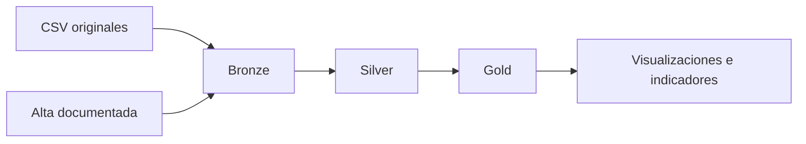

# TP7 — Análisis de datos del fútbol argentino con Databricks y Apache Spark

**Materia:** Análisis de datos en la nube  
**Integrantes:** Gianfranco Godoy y Maximiliano Dias

## Descripción

Trabajo práctico de procesamiento y análisis de datos mediante un pipeline ETL en Databricks Free Edition. Se utiliza una muestra de clubes del fútbol argentino para aplicar técnicas de exploración, limpieza, enriquecimiento, almacenamiento y visualización con Apache Spark y Delta Lake.

## Objetivos

- Cargar y explorar archivos CSV mediante PySpark y Spark SQL.
- Eliminar duplicados, tratar valores faltantes y generar columnas calculadas.
- Integrar datos de clubes y regiones mediante un JOIN.
- Implementar una arquitectura Medallion y validar la integridad de las tablas Delta.
- Demostrar el historial de versiones mediante Delta Lake Time Travel.
- Interpretar indicadores geográficos y temporales mediante gráficos.

## Tecnologías utilizadas

Databricks Free Edition (Serverless), Python, PySpark, Spark SQL, Delta Lake, Unity Catalog, Pandas, Matplotlib y Git/GitHub.

## Datos de entrada

| Archivo | Descripción |
| --- | --- |
| `equipos_futbol_argentino.csv` | 32 filas originales correspondientes a 30 clubes únicos. Contiene equipo, ciudad, provincia, año de fundación y estadio, con duplicados y faltantes intencionales. |
| `provincias_regiones.csv` | Dimensión auxiliar de ocho jurisdicciones y sus regiones. |

Los CSV originales se mantienen intactos. Se incorpora Gimnasia y Esgrima de Mendoza mediante una tabla de altas independiente, con referencias registradas en el notebook.

## Arquitectura Medallion



| Capa | Procesamiento |
| --- | --- |
| Bronze | Ingesta con esquemas explícitos, conservación de datos originales y registro separado del alta. |
| Silver | Normalización, eliminación de duplicados, conversión de tipos, tratamiento de faltantes, cálculo de antigüedad y década, filtros y JOIN con regiones. Se conservan valores originales y referencias de las correcciones. |
| Gold | Agregaciones por jurisdicción, región y década de fundación, indicadores de calidad y antigüedad promedio. |

La antigüedad se calcula tomando 2026 como año de referencia. Los gráficos se generan a partir de pequeñas tablas agregadas convertidas a Pandas.

## Delta Lake y calidad de datos

Las tablas se almacenan en formato Delta y se administran mediante Unity Catalog. El notebook comprueba la integridad de los datos escritos y leídos, la unicidad de los clubes, la ausencia de pérdidas en el JOIN y la reconciliación de las agregaciones con Silver.

Para demostrar Time Travel se utiliza una tabla independiente: primero se registra el año de fundación faltante de Estudiantes de La Plata y luego se actualiza a 1905. Se consultan ambas versiones mediante `VERSION AS OF` y se verifica el cambio mediante aserciones.

## Resultados principales

| Indicador | Resultado |
| --- | ---: |
| Filas originales | 32 |
| Duplicados eliminados | 2 |
| Clubes incorporados | 1 |
| Clubes únicos finales | 31 |
| Clubes de Mendoza | 3 |
| Clubes de Cuyo | 4 |
| Clubes de la región Centro | 25 (80,6 %) |
| Fundaciones en la década de 1900 | 18 |
| Años de fundación faltantes al finalizar | 0 |
| Estadios faltantes al finalizar | 0 |

### Visualizaciones

El notebook incluye cuatro gráficos:

1. Cantidad de clubes por jurisdicción.
2. Fundaciones por década.
3. Antigüedad promedio por región.
4. Comparación de completitud antes y después de corregir faltantes.

## Estructura del repositorio

```text
tp_databricks-spark/
├── README.md
├── equipos_futbol_argentino.csv
├── provincias_regiones.csv
├── TP7_Databricks_FutbolArgentino.ipynb
└── TP7_Databricks_FutbolArgentino.html
```

- [Notebook definitivo](TP7_Databricks_FutbolArgentino.ipynb): código comentado y resultados.
- [Exportación HTML](TP7_Databricks_FutbolArgentino.html): versión para descargar y abrir en un navegador.

## Cómo reproducir el proyecto

1. Clonar o descargar el repositorio.
2. Acceder a Databricks Free Edition e importar el archivo `.ipynb`.
3. Crear o utilizar el volumen `workspace.default.tp_volume` y cargar los dos CSV con sus nombres originales.
4. Verificar que la variable `BASE` apunte a `/Volumes/workspace/default/tp_volume/` y que se disponga de permisos para crear el esquema de trabajo. Si el entorno es diferente, adaptar `BASE` y `DB`.
5. Conectar el notebook al cómputo Serverless y ejecutar todas las celdas en orden.
6. Revisar las tablas, los gráficos y los mensajes de validación.

El esquema configurado internamente es `workspace.tp7_futbol_v6`. Las escrituras reemplazan las tablas del proyecto dentro de ese esquema; utilizar un esquema propio si se necesita preservar una ejecución anterior.

## Referencias y limitaciones

Las referencias de las correcciones se encuentran en el notebook, incluyendo sitios institucionales y directorios secundarios. Entre ellas:

- [Liga Profesional de Fútbol — Gimnasia de Mendoza](https://www.ligaprofesional.ar/clubes/gimnasia-de-mendoza/).
- [Estudiantes de La Plata — Historia](https://estudiantesdelaplata.com/historia/).
- [Instituto — Instalaciones](https://institutoacc.com.ar/index.php/instalaciones/).

La muestra no representa un censo ni una nómina oficial de una temporada del fútbol argentino. La ausencia de valores faltantes no garantiza la exactitud histórica de todos los registros: los datos originales no fueron auditados individualmente. Los estadios representan recintos asociados a los clubes y no necesariamente la sede de todos sus partidos. Las referencias secundarias deben contrastarse con fuentes oficiales para usos ajenos al trabajo práctico.

## Conclusiones

El pipeline permitió transformar datos con duplicados y faltantes en un conjunto de 31 clubes únicos, con indicadores reproducibles y validaciones de integridad. La región Centro concentra el 80,6 % de la muestra y la década de 1900 presenta la mayor cantidad de fundaciones registradas.

La arquitectura Medallion separa la ingesta, la transformación y el análisis, mientras que Delta Lake permite persistir los resultados y consultar versiones históricas. El trabajo demuestra la aplicación integrada de herramientas de ingeniería y análisis de datos en un entorno de procesamiento en la nube.
